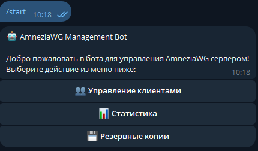
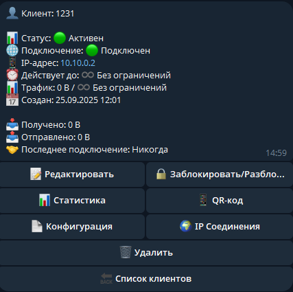
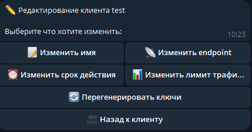
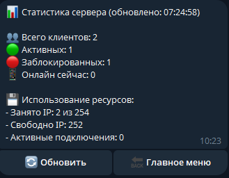
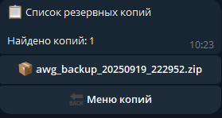

> ** Moved ** development continues at https://git.shd.company/bubblegum/AWG_Bot2.0. This GitHub copy is archived.

# <div align="center"> 🤖 AmneziaWG Management Bot

<div align="center">

[](LICENSE)
[](https://www.python.org/)
[](https://telegram.org/)
[](https://docs.aiogram.dev/)

Профессиональный Telegram бот для управления AmneziaWG VPN сервером с полным функционалом администрирования, мониторинга и автоматизации.

**⚠️ Важно:** Для работы бота требуются root-права и установленный AmneziaWG.

</div>

---

## 📑 Содержание

- [Возможности](#-возможности)
- [Демонстрация](#-демонстрация)
- [Требования](#-требования)
- [Архитектура](#️-архитектура-проекта)
- [Быстрый старт](#-быстрый-старт)
- [Установка](#️-полная-установка)
- [Настройка AmneziaWG](#️-настройка-amneziawg)
- [Использование](#-использование)
- [Производительность](#-оптимизация-и-производительность)
- [Безопасность](#-безопасность)
- [Решение проблем](#-решение-проблем)
- [FAQ](#-часто-задаваемые-вопросы)
- [Roadmap](#-планы-развития)
- [Вклад в проект](#-вклад-в-проект)
- [Лицензия](#-лицензия)

---

## 🚀 Возможности

### Управление клиентами
- ➕ **Создание клиентов** с автоматической генерацией ключей и IP-адресов
- 🗑️ **Удаление клиентов** с полной очисткой конфигураций
- 🔒 **Блокировка/разблокировка** без потери данных
- ✏️ **Редактирование** параметров существующих клиентов

### Контроль доступа
- ⏰ **Временные ограничения**: 1 час, 1 день, 1 неделя, 1 месяц, произвольный срок, постоянный доступ
- 📊 **Лимиты трафика**: 5GB, 10GB, 30GB, 100GB, без ограничений
- 🔄 **Автоматическая блокировка** при превышении лимитов
- ⏱️ **Фоновый мониторинг** с проверкой каждые 5 минут

### Мониторинг и статистика
- 📈 **Статистика сервера**: нагрузка, количество активных клиентов, общий трафик
- 📊 **Индивидуальная статистика**: трафик, время подключения, история IP
- 🌍 **Геолокация IP**: определение примерного местоположения подключений через ip-api.com
- 📝 **История подключений**: отслеживание IP-адресов

### Конфигурации и экспорт
- 📱 **QR-коды** для мгновенного подключения
- 🔗 **Ключи vpn://** для быстрого импорта в [AmneziaVPN](https://github.com/amnezia-vpn/amnezia-client)
- 📄 **Экспорт конфигураций** в формате AmneziaWG (WireGuard)
- 🌐 **Поддержка IPv6** для всех клиентов

### Резервное копирование
- 💾 **Полные резервные копии**: база данных + конфигурации AWG
- ♻️ **Восстановление** из любой точки сохранения
- 🗂️ **Управление бэкапами** через интерфейс бота
- ⏰ **Автоматическое создание** при критических операциях

---

## 📸 Демонстрация

| Главное меню | Детали клиента | Редактирование | Статистика | Бэкапы |
|--------------|----------------|----------------|------------|--------|
|  |  |  |  |  |

---

## 📋 Требования

### Системные требования
- **ОС**: Ubuntu 20.04+ / Debian 11+ (рекомендуется Ubuntu 22.04 LTS)
- **Архитектура**: x86_64 / ARM64
- **RAM**: минимум 512MB (рекомендуется 1GB)
- **Диск**: минимум 1GB свободного места

### Программное обеспечение
- **Python**: 3.12 или выше
- **AmneziaWG**: последняя стабильная версия
- **Root-доступ**: требуется для управления сетевым интерфейсом
- **Telegram Bot Token**: получить у [@BotFather](https://t.me/BotFather)

### Сетевые требования
- Открытый UDP порт для AmneziaWG (по умолчанию 51820)
- Доступ к Telegram API (api.telegram.org)
- Доступ к ip-api.com для геолокации (опционально)

---

## 🏗️ Архитектура проекта

```
AWG_Bot2.0/
├── main.py                         # Точка входа приложения
├── config.py                       # Конфигурация проекта
├── requirements.txt                # Python зависимости
└── handlers/                       # Обработчики событий Telegram
    ├── init.py           
    ├── admin_handlers.py           # Обработчики команд администратора 
├── middlewares/                    # Промежуточное ПО
    ├── init.py         
    ├── auth.py                     # Аутентификация администраторов
├── keyboards/                      # Telegram клавиатуры
    ├── init.py         
    ├── main_keyboards.py           # Основные inline клавиатуры
├── database/                       # Работа с базой данных
    ├── init.py        
    ├── database.py                 # ORM, модели, пул соединений
├── services/                       # Бизнес-логика
    ├── init.py        
    ├── awg_manager.py              # Управление AmneziaWG
    ├── ip_service.py               # Работа с IP-адресами и геолокацией
    ├── backup_service.py           # Резервное копирование
    ├── settings_service.py         # Управление настройками        
└── utils/                          # Вспомогательные утилиты
    ├── init.py  
    ├── qr_generator.py             # Генерация QR-кодов
    ├── formatters.py               # Форматирование данных
    └── vpn_converter.py            # Конвертация в vpn:// формат
```

### Ключевые компоненты

#### database.py
- **DatabaseConnectionPool** - пул из 5 постоянных соединений
- **Database** - основной класс для работы с БД
- Модели: `Client`, `BotSettings`, `ClientIPConnection`
- Оптимизации: индексы, PRAGMA настройки, кэширование
- Пакетные операции для высокой производительности

#### awg_manager.py
- Управление интерфейсом AmneziaWG
- Генерация ключей и конфигураций
- Добавление/удаление пиров
- Получение статистики трафика
- Проверка доступности AWG

#### admin_handlers.py
- FSM (Finite State Machine) для многошаговых операций
- Обработка callback-запросов
- Валидация пользовательского ввода
- Интерактивные меню

---

## ⚡ Быстрый старт

Для опытных пользователей с уже установленным Python 3.12+ и AmneziaWG:

Клонирование репозитория
```bash
git clone https://github.com/JB-SelfCompany/AWG_Bot2.0.git
cd AWG_Bot2.0
```

Создание виртуального окружения
```bash
python3.12 -m venv venv
source venv/bin/activate
```

Установка зависимостей
```bash
pip install -r requirements.txt
```

Настройка конфигурации
```bash
nano config.py
```

Укажите: BOT_TOKEN, ADMIN_IDS, SERVER_IP, AWG_INTERFACE
Запуск бота
```bash
python main.py
```

> Для детальной установки с настройкой всех компонентов см. раздел [Полная установка](#️-полная-установка).

---

## 🛠️ Полная установка

### Шаг 1: Подготовка системы

#### Ubuntu/Debian

Обновление системы
```bash
sudo apt update && sudo apt upgrade -y
```

Установка необходимых зависимостей
```bash
sudo apt install -y make build-essential libssl-dev zlib1g-dev \
libbz2-dev libreadline-dev libsqlite3-dev wget curl llvm \
libncurses-dev xz-utils tk-dev libffi-dev liblzma-dev python3-openssl git
```
---

### Шаг 2: Установка Python 3.12 через pyenv

#### Установка pyenv

Загрузка и установка pyenv
```bash
curl https://pyenv.run | bash
```

Добавление в .bashrc (или .zshrc для zsh)
```bash
cat >> ~/.bashrc << 'EOF'
export PYENV_ROOT="$HOME/.pyenv"
[[ -d $PYENV_ROOT/bin ]] && export PATH="$PYENV_ROOT/bin:$PATH"
eval "$(pyenv init -)"
EOF
```

Применение изменений
```bash
source ~/.bashrc
```

Проверка установки
```bash
pyenv --version
```

#### Установка Python 3.12

Установка Python 3.12.11
```bash
pyenv install 3.12.11
```

Создание виртуального окружения
```bash
pyenv virtualenv 3.12.11 awg_bot_env
```

Активация окружения в текущей директории
```bash
pyenv local awg_bot_env
```

---

### Шаг 3: Установка AmneziaWG

Установите AmneziaWG согласно официальной документации.

---

### Шаг 4: Настройка проекта

Клонирование репозитория
```bash
git clone https://github.com/JB-SelfCompany/AWG_Bot2.0.git
cd AWG_Bot2.0
```

Активация окружения (если не активировано)
```bash
pyenv local awg_bot_env
```

Установка зависимостей Python
```bash
pip install --upgrade pip
pip install -r requirements.txt
```

---

### Шаг 5: Конфигурация

#### Настройка config.py

- `BOT_TOKEN` - Токен Telegram бота от @BotFather
- `ADMIN_IDS` - ID администраторов через запятую
- `SERVER_IP` - Внутренний IP адрес сервера (на интерфейсе)
- `AWG_INTERFACE` - Имя интерфейса AmneziaWG (по умолчанию: awg0)
- `SERVER_PORT` - Порт сервера (по умолчанию: 51820)
- `SERVER_SUBNET` - Подсеть сервера (по умолчанию: 10.10.0.0/24)
- `AWG_CONFIG_DIR` - Директория конфигураций AWG
- `DATABASE_PATH` - Путь к файлу базы данных
- `BACKUP_DIR` - Директория для резервных копий

#### Получение Bot Token

1. Откройте [@BotFather](https://t.me/BotFather) в Telegram
2. Отправьте команду `/newbot`
3. Следуйте инструкциям и получите токен
4. Вставьте токен в `config.py`

#### Получение Admin ID

1. Откройте [@userinfobot](https://t.me/userinfobot) в Telegram
2. Бот автоматически отправит ваш ID
3. Добавьте ID в список `admin_ids` в `config.py`

---

### Шаг 6: Настройка systemd (рекомендуется)

Создание systemd-юнита для автоматического запуска бота:

Создание файла сервиса
```bash
sudo nano /etc/systemd/system/awg_bot.service
```

Содержимое файла:
```bash
[Unit]
Description=AmneziaWG Telegram Management Bot

[Service]
Type=simple
User=root
WorkingDirectory=/path/to/AWG_Bot2.0
ExecStart=/root/.pyenv/versions/awg_bot_env/bin/python main.py
Restart=always
RestartSec=10

[Install]
WantedBy=multi-user.target
```
> **⚠️ Важно:** Замените `/path/to/AWG_Bot2.0` на реальный путь к директории проекта.

Активация сервиса:

Перезагрузка конфигурации systemd
```bash
sudo systemctl daemon-reload
```

Запуск бота
```bash
sudo systemctl start awg_bot.service
```

Добавление в автозагрузку
```bash
sudo systemctl enable awg_bot.service
```

Проверка статуса
```bash
sudo systemctl status awg_bot.service
```

Просмотр логов
```bash
sudo journalctl -u awg_bot.service -f
```

---

## ⚙️ Настройка AmneziaWG

### Базовая конфигурация сервера

Создайте конфигурационный файл `/etc/amnezia/amneziawg/awg0.conf`:

```bash
sudo mkdir -p /etc/amnezia/amneziawg
sudo nano /etc/amnezia/amneziawg/awg0.conf
```

Минимальная конфигурация:

```bash
[Interface]
PrivateKey = <your_server_private_key>
Address = 10.10.0.1/24
ListenPort = 51820
PostUp = iptables -t nat -A POSTROUTING -o `ip route | awk '/default/ {print $5; exit}'` -j MASQUERADE
PostDown = iptables -t nat -D POSTROUTING -o `ip route | awk '/default/ {print $5; exit}'` -j MASQUERADE
```

### Включение IP forwarding

Временное включение
```bash
sudo sysctl -w net.ipv4.ip_forward=1
sudo sysctl -w net.ipv6.conf.all.forwarding=1 # для IPv6
```

Постоянное включение
```bash
echo "net.ipv4.ip_forward=1" | sudo tee -a /etc/sysctl.conf
echo "net.ipv6.conf.all.forwarding=1" | sudo tee -a /etc/sysctl.conf
sudo sysctl -p
```

### Запуск AmneziaWG

Запуск интерфейса
```bash
sudo awg-quick up awg0
```

Проверка статуса
```bash
sudo awg show awg0
```

Добавление в автозагрузку
```bash
sudo systemctl enable awg-quick@awg0
```

---

## 📚 Использование

### Основные команды

- `/start` - Запуск бота и отображение главного меню

### Управление клиентами

#### Добавление нового клиента

1. В главном меню выберите **"👥 Управление клиентами"**
2. Нажмите **"➕ Добавить клиента"**
3. Введите **уникальное имя** клиента (например: `user1`, `client-mobile`)
4. Укажите **endpoint** (если не задан глобально в конфигурации)
5. Выберите **срок действия**:
   - 1 час - для тестовых подключений
   - 1 день - краткосрочный доступ
   - 1 неделя - средний срок
   - 1 месяц - стандартный период
   - Свой срок - произвольная дата и время
   - Постоянная - без ограничений по времени
6. Установите **лимит трафика**:
   - 5 GB, 10 GB, 30 GB, 100 GB
   - Без ограничений - неограниченный трафик

После создания клиент автоматически добавляется в AWG, и генерируется:
- Конфигурационный файл
- QR-код для быстрого подключения
- VPN-ссылка для AmneziaVPN

#### Просмотр и управление клиентами

1. **"👥 Управление клиентами"** → **"📋 Список клиентов"**
2. Выберите клиента из списка
3. Доступные действия:
   - ✏️ **Редактировать** - изменение параметров
   - 🔒 **Заблокировать/Разблокировать** - управление доступом
   - 📊 **Статистика** - просмотр использования трафика
   - 📱 **QR-код** - для сканирования в мобильном приложении
   - 📄 **Конфигурация** - скачивание .conf файла
   - 🔗 **IP-соединения** - Просмотр IP-адресов подключения
   - 🗑️ **Удалить** - полное удаление клиента

#### Редактирование клиента

При редактировании можно изменить:
- Имя клиента
- Endpoint
- Срок действия
- Лимит трафика
- Перегенерация ключей

### Статистика

#### Статистика сервера

**"📊 Статистика сервера"** показывает:
- Общее количество клиентов
- Активные клиенты
- Заблокированные клиенты
- Суммарный трафик

#### Статистика клиента

Для каждого клиента доступна:
- Использованный трафик (RX/TX)
- Последнее подключение
- История IP-адресов
- Геолокация подключений
- Количество подключений за день

### Резервное копирование

#### Создание резервной копии

1. **"💾 Резервные копии"** → **"➕ Создать бэкап"**
2. Бот автоматически сохраняет:
   - База данных SQLite
   - Конфигурации AWG
   - Файл конфигурации бота
3. Бэкап сохраняется в директорию `backups/` с временной меткой

#### Восстановление из бэкапа

1. **"💾 Резервные копии"** → **"📋 Список бэкапов"**
2. Выберите нужный бэкап
3. Подтвердите восстановление
4. Бот автоматически:
   - Остановит AWG интерфейс
   - Восстановит базу данных
   - Восстановит конфигурации
   - Перезапустит AWG

> **⚠️ Внимание:** При восстановлении текущие данные будут перезаписаны.

#### Удаление бэкапов

Старые бэкапы можно удалить через интерфейс бота для освобождения места.

---

## ⚡ Оптимизация и производительность

### База данных

Реализованы следующие оптимизации SQLite:

#### Connection Pooling
- Пул из 5 переиспользуемых соединений
- Устраняет overhead на открытие/закрытие
- Поддерживает "горячий" кэш SQLite

#### PRAGMA оптимизации
```
PRAGMA journal_mode = WAL; -- Write-Ahead Logging
PRAGMA synchronous = NORMAL; -- Баланс скорости/безопасности
PRAGMA cache_size = 10000; -- 40MB кэш
PRAGMA temp_store = MEMORY; -- Временные данные в RAM
PRAGMA mmap_size = 268435456; -- 256MB memory-mapped I/O
PRAGMA page_size = 4096; -- Оптимальный размер страницы
```

#### Индексирование
Созданы индексы на всех часто используемых колонках:
- `idx_clients_name`, `idx_clients_public_key`
- `idx_clients_ip_address`, `idx_clients_is_active`
- `idx_ip_client_date` для быстрой выборки истории

#### In-Memory кэширование
- TTL кэш для часто запрашиваемых данных
- Автоматическая инвалидация при изменениях
- Снижение нагрузки на диск

#### Пакетные операции
- `update_clients_batch()` для массовых обновлений
- Единая транзакция для группы операций

### Мониторинг производительности

Фоновая задача `check_client_limits()`:
- Проверяет лимиты каждые 5 минут
- Обновляет статистику трафика
- Блокирует клиентов при превышении
- Минимальная нагрузка на систему

---

## 🔐 Безопасность

### Аутентификация
- Проверка ID пользователя перед каждым действием
- Middleware для фильтрации несанкционированного доступа
- Только администраторы из `ADMIN_IDS` имеют доступ

### Валидация данных
- Проверка всех пользовательских вводов
- Санитизация имен файлов и путей
- Защита от SQL-инъекций через параметризованные запросы
- Валидация IP-адресов и сетевых параметров

### Хранение конфигураций
- Приватные ключи не логируются
- Конфигурации AWG защищены правами доступа
- База данных доступна только root
- Резервные копии сжимаются и защищаются

### Логирование
- Детальные логи всех операций
- Не логируются конфиденциальные данные (токены, ключи)
- Логи ошибок с traceback для отладки
- Ротация логов для предотвращения переполнения

### Рекомендации по безопасности

1. **Используйте сильные токены** - не используйте тестовые токены в production
2. **Ограничьте доступ к серверу** - используйте firewall
3. **Регулярные обновления** - обновляйте систему и зависимости
4. **Резервное копирование** - делайте регулярные бэкапы
5. **Мониторинг логов** - регулярно проверяйте логи на подозрительную активность

---

## 🔧 Решение проблем

### Бот не запускается

**Проблема:** `BOT_TOKEN не найден в конфигурации`

**Решение:**
Проверьте config.py
```bash
nano config.py
```

Убедитесь что bot_token заполнен корректным токеном

**Проблема:** `AmneziaWG недоступен`

**Решение:**
Проверьте установку AWG
```bash
awg --version
```

Проверьте статус интерфейса
```bash
sudo awg show awg0
```

Если интерфейс не работает, запустите его
```bash
sudo awg-quick up awg0
```

### Проблемы с базой данных

**Проблема:** `database is locked`

**Решение:**
Остановите бота
```bash
sudo systemctl stop awg_bot.service
```

Проверьте процессы, использующие БД
```bash
sudo lsof clients.db
```

Перезапустите бота
```bash
sudo systemctl start awg_bot.service
```

### Проблемы с сетью

**Проблема:** Клиенты не могут подключиться к VPN

**Решение:**
Проверьте IP forwarding
```bash
sysctl net.ipv4.ip_forward # должно быть 1
```

Проверьте правила iptables
```bash
sudo iptables -t nat -L -n -v | grep MASQUERADE
```

Проверьте открытость порта
```bash
sudo ss -ulnp | grep 51820
```

Проверьте firewall
```bash
sudo ufw status
sudo ufw allow 51820/udp
```

**Проблема:** Геолокация не работает

**Решение:**
Проверьте доступность ip-api.com
```bash
curl -s "http://ip-api.com/json/8.8.8.8"
```

Если API недоступно, бот продолжит работу без геолокации

### Проблемы с правами доступа

**Проблема:** `Permission denied при доступе к AWG`

**Решение:**
Убедитесь что бот запущен от root
```bash
sudo systemctl status awg_bot.service | grep User
```

Проверьте права на конфигурационную директорию
```bash
ls -la /etc/amnezia/amneziawg/
```

Исправьте права если необходимо
```bash
sudo chown -R root:root /etc/amnezia/amneziawg/
sudo chmod 700 /etc/amnezia/amneziawg/
```

### Просмотр логов

Логи systemd
```bash
sudo journalctl -u awg_bot.service -f
```

Файл логов бота
```bash
tail -f bot.log
```

Логи с ошибками
```bash
grep ERROR bot.log
```

---

## ❓ Часто задаваемые вопросы

### Можно ли использовать бота без root прав?

Нет, для управления сетевым интерфейсом AmneziaWG требуются root права.

### Поддерживается ли IPv6?

Да, IPv6 поддерживается. Включите параметр `ipv6_enabled: bool = True` в конфигурации и настройте IPv6 подсеть в AWG.

### Как ограничить количество одновременных подключений с одного аккаунта?

В текущей версии отслеживается история IP, но ограничение одновременных подключений не реализовано.

### Можно ли управлять несколькими серверами AWG?

В текущей версии - нет. Один бот управляет одним сервером AWG на одном интерфейсе.

### Как мигрировать на другой сервер?

1. Создайте резервную копию через бота
2. Скачайте файл бэкапа из директории `backups/`
3. Установите бота на новом сервере
4. Восстановите бэкап через интерфейс бота

### Безопасно ли хранить конфигурации в боте?

Да, все конфигурации защищены на уровне файловой системы. Приватные ключи не передаются через Telegram без шифрования.

---

## 🚀 Планы развития

### Версия 2.1 (планируется)

- [x] **Многопользовательский режим** - раздельное управление для нескольких администраторов
- [x] **Уведомления** - оповещения о превышении лимитов, истечении срока
- [ ] **Webhook режим** - альтернатива long polling для больших нагрузок
- [ ] **API интеграция** - REST API для внешних систем
- [ ] **Множественные серверы** - управление несколькими AWG серверами

---

## 🤝 Вклад в проект

Мы приветствуем вклад в развитие проекта! Вот как можно помочь:

### Сообщение о багах

Если обнаружили баг, пожалуйста:
1. Проверьте, что он еще не был reported в [Issues](https://github.com/JB-SelfCompany/AWG_Bot2.0/issues)
2. Создайте новый Issue с подробным описанием:
   - Шаги для воспроизведения
   - Ожидаемое поведение
   - Фактическое поведение
   - Версия Python, ОС
   - Логи ошибок

### Предложение функционала

Для предложения новых функций:
1. Создайте Issue с тегом `enhancement`
2. Опишите функционал и его преимущества
3. Если возможно, приложите примеры использования

### Pull Requests

1. Fork репозитория
2. Создайте feature-ветку (`git checkout -b feature/AmazingFeature`)
3. Commit изменения (`git commit -m 'Add some AmazingFeature'`)
4. Push в ветку (`git push origin feature/AmazingFeature`)
5. Откройте Pull Request

### Стиль кода

- Следуйте [PEP 8](https://pep8.org/)
- Используйте type hints где возможно
- Документируйте функции и классы docstrings
- Пишите понятные комментарии на русском языке

---

## 📄 Лицензия

Этот проект распространяется под лицензией GNU General Public License v3.0.

Основные положения:
- ✅ Свободное использование
- ✅ Изменение и распространение
- ✅ Коммерческое использование
- ⚠️ Обязательно открытие исходного кода при распространении
- ⚠️ Указание оригинального автора

Полный текст лицензии: [LICENSE](LICENSE)

---

## 👨‍💻 Автор

**JB-SelfCompany**

- GitHub: [@JB-SelfCompany](https://github.com/JB-SelfCompany)
- Project: [AWG_Bot2.0](https://github.com/JB-SelfCompany/AWG_Bot2.0)

---

## 🙏 Благодарности

- [AmneziaVPN](https://github.com/amnezia-vpn) - за разработку AmneziaWG
- [aiogram](https://github.com/aiogram/aiogram) - за отличный фреймворк для Telegram ботов
- [WireGuard](https://www.wireguard.com/) - за революционный VPN протокол
- Все контрибьюторы проекта

---

## 📞 Поддержка

При возникновении вопросов:

1. **Документация** - проверьте [README](#) и [Wiki](https://github.com/JB-SelfCompany/AWG_Bot2.0/wiki)
2. **FAQ** - найдите ответ в разделе [FAQ](#-часто-задаваемые-вопросы)
3. **Issues** - создайте [Issue](https://github.com/JB-SelfCompany/AWG_Bot2.0/issues)
4. **Discussions** - задайте вопрос в [Discussions](https://github.com/JB-SelfCompany/AWG_Bot2.0/discussions)

---

<div align="center">

**Сделано с ❤️ для open-source сообщества**

⭐ Если проект вам помог, поставьте звезду на GitHub!

[Наверх](#amneziawg-management-bot)

</div>
